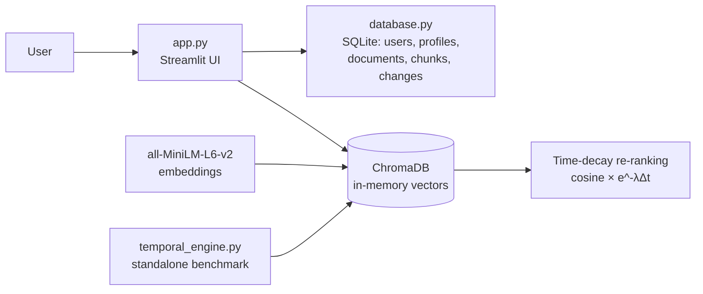

# ⏳ CHRONO-RAG

**Time-aware Retrieval-Augmented Generation for regulatory documents.**
Standard RAG ranks by semantic similarity alone, so an outdated rule can outrank the current one. ChronoRAG adds an exponential time-decay to the score so the **version in force for the year you care about wins**.


---

## 🧠 The Problem

Regulations get rewritten. Searching "what is the surrender value rule?" over a pile of circulars from 2020, 2024 and 2026 returns whichever text *sounds* closest to the question, not the one that is currently valid.

## 💡 The Idea: Dual-Route Retrieval

Every query is scored two ways and the results are compared side by side:

| Route | Score | Behaviour |
|---|---|---|
| **Standard RAG** (λ = 0) | `cosine_sim` | Time-agnostic. Old and new versions compete equally. |
| **ChronoRAG** (λ = 0.35) | `cosine_sim × e^(−λ · \|target_year − doc_year\|)` | Documents far from the target year are penalised. |

```
final_score = cosine_similarity × exp(−λ × |target_year − document_year|)
```

- `λ` (decay rate) controls how aggressively old versions are demoted. It is configurable per user.
- `target_year` is the year you want the answer to be valid for (default 2026).

### Example: remote-work policy in 3 versions

`temporal_engine.py` indexes three versions of a company policy (2022, 2024, 2026) and runs the same query through both routes. Run it to see how the ranking changes:

```bash
python temporal_engine.py
```

## 🏛 LIC Regulatory Intelligence Portal

A Streamlit app built around the same idea, applied to Indian life-insurance regulation (IRDAI / LIC).

| Screen | Purpose |
|---|---|
| **Hub** | Landing page with quick actions and recent updates |
| **Ask a Policy Question** | Natural-language Q&A with cited sources |
| **Compare Regulations** | Year-to-year changes in rules (e.g. 2020 → 2024 → 2026) |
| **Regulatory Timeline** | Chronological view of circulars and effective dates |
| **Document Library** | Browse, upload and verify documents |

Plus: **Reports** (searchable, paginated, CSV export) and a **Knowledge Base** with a document inspector.

### Seeded regulatory story

The database ships with three verified documents that show a real regulatory evolution of surrender-value rules:

1. **2020**: IRDAI GSV scale, 3-year lock-in, 100% first-year forfeiture
2. **2024**: IRDAI Master Circular, forfeiture abolished, Special Surrender Value after 1 year
3. **2026**: LIC directive, SSV computed from the 10-year G-Sec yield + 50 bps

## ✨ Features

- ⏱ Time-decay retrieval with adjustable `λ` and target year
- 🔐 Multi-user authentication (PBKDF2-SHA256, per-user salt, constant-time comparison)
- 👤 User profiles with cropped avatar upload, password change and per-user retrieval settings
- 💾 SQLite persistence with foreign keys and cascading deletes
- ✅ Document verification workflow (`Verified`, `Pending Verification`, `Conflicting Sources`, `Insufficient Evidence`, `Extraction Error`)
- 🧩 Chunk-level storage with section headings and page numbers for citations
- 🔁 Structured change records linking an earlier clause to its updated clause
- 📤 CSV export of the reports index
- 🌐 API endpoint connectivity check in System Environment settings

## 🏗 Architecture



### Repository layout

```
CHRONO-RAG/
├── app.py               # Streamlit portal (auth, 5 LIC screens, reports, profile)
├── database.py          # SQLite schema, seed data, auth and CRUD helpers
├── temporal_engine.py   # Standalone Standard-RAG vs ChronoRAG comparison
├── requirements.txt
├── LICENSE
└── README.md
```

### Database schema

`users` → `profiles`, `user_settings` (1:1, cascade delete)
`regulatory_documents` → `regulatory_chunks` (1:N)
`regulatory_changes` links `earlier_doc_id` and `updated_doc_id`

## 🚀 Quick Start

```bash
git clone https://github.com/yashsahu815/CHRONO-RAG.git
cd CHRONO-RAG

python -m venv .venv
source .venv/bin/activate        # Windows: .venv\Scripts\activate

pip install -r requirements.txt

streamlit run app.py
```

The first run downloads the `all-MiniLM-L6-v2` embedding model (~90 MB) and creates a local `chronorag.db`. Register an account on the login screen to get in.

## 🛠 Tech Stack

- **Python 3.10+**
- **Streamlit**: UI
- **ChromaDB**: vector store (cosine space)
- **sentence-transformers** (`all-MiniLM-L6-v2`): local embeddings
- **SQLite**: users, documents, chunks, regulatory changes
- **Pillow**: avatar processing

## 📍 Project Status

This is an active prototype.

- ✅ Working: time-decay retrieval engine, auth, profiles, SQLite schema and seed data, reports table with filtering, pagination and CSV export
- 🚧 In progress: the Q&A, Compare, Timeline and Library screens currently display sample data. Connecting them to the database and the retrieval engine is the next step.

## 🗺 Roadmap

- [ ] Wire the Q&A screen to live ChronoRAG retrieval with real citations
- [ ] Drive Compare and Timeline from `regulatory_changes`
- [ ] PDF / HTML ingestion with automatic chunking in the Library
- [ ] LLM answer generation on top of retrieved clauses
- [ ] Benchmark suite: Standard RAG vs ChronoRAG accuracy on temporally-sensitive queries
- [ ] Learned / per-category decay rates instead of one global `λ`
- [ ] Docker setup and a hosted demo

## ⚠️ Disclaimer

The seeded regulatory text is illustrative and not legal or financial advice. Verify against official IRDAI and LIC publications.

## 📄 License

MIT. See [LICENSE](LICENSE).

---

Built by [Yash Sahu](https://github.com/yashsahu815)
